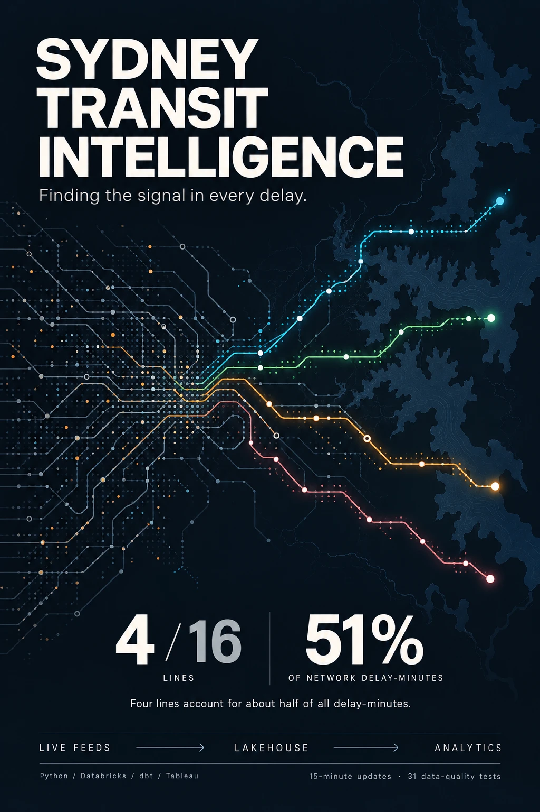
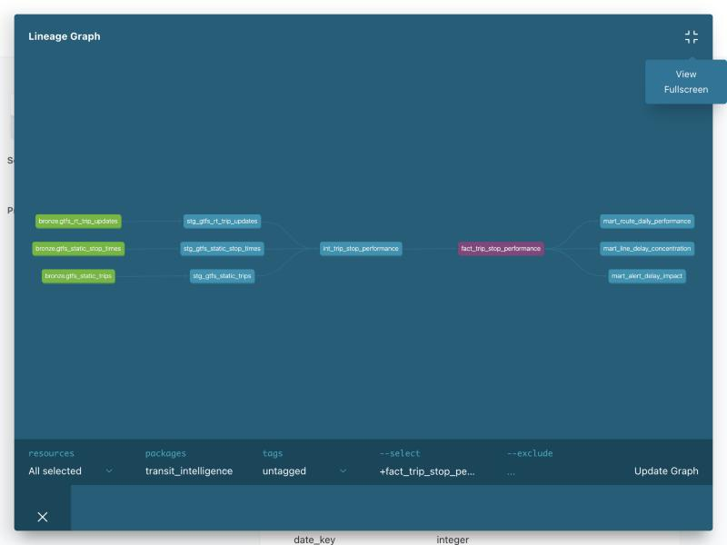
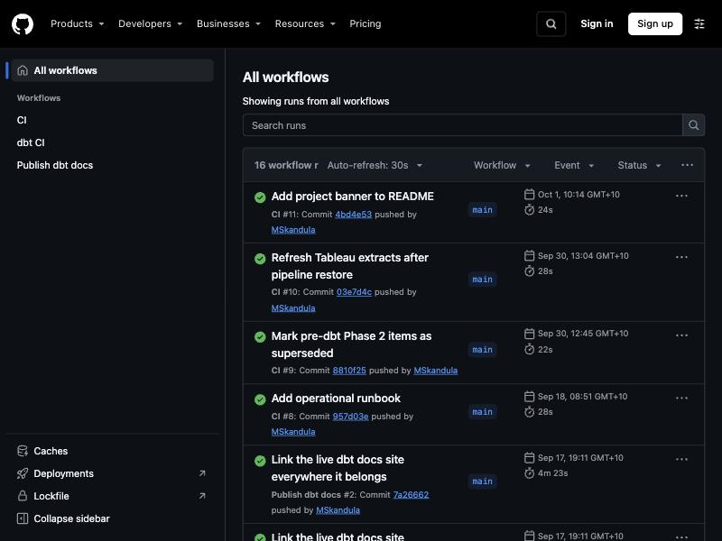
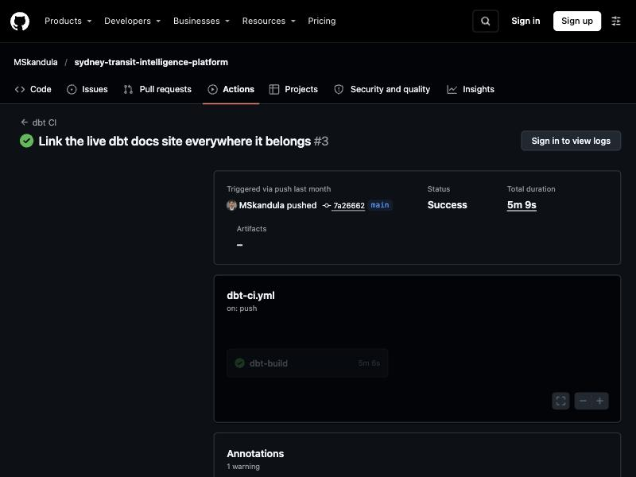
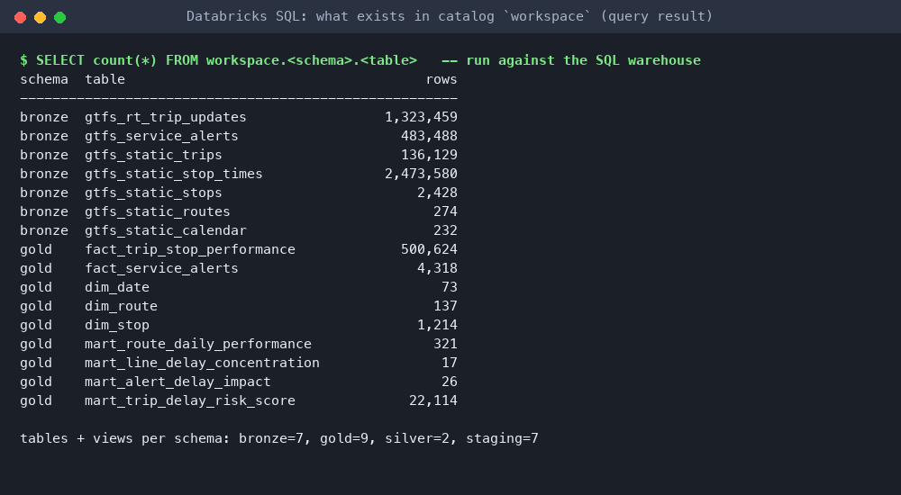
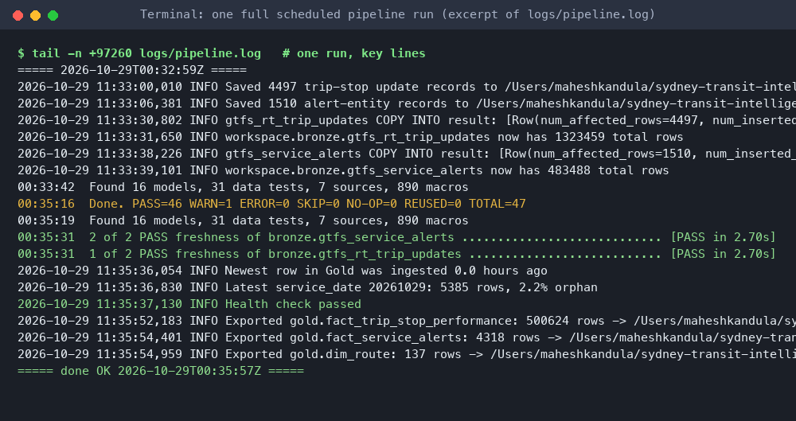
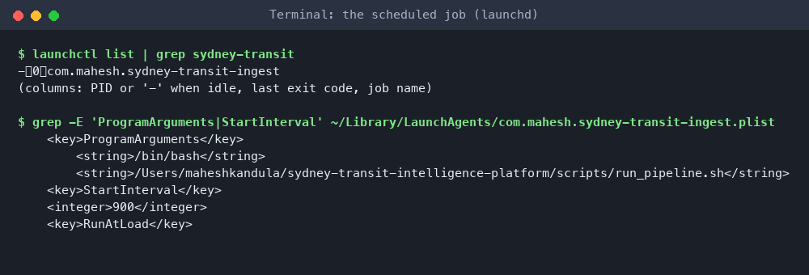
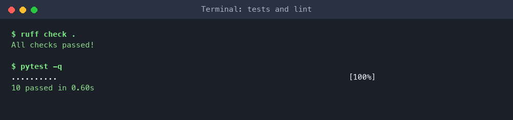
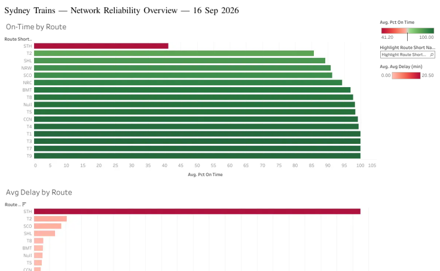

# Sydney Transit Intelligence Platform



An analytics platform that ingests live public transport data from Transport for
NSW (TfNSW) to measure, explain, and surface where Sydney's rail network is
underperforming — and why.

## The problem

TfNSW publishes a live GTFS-Realtime feed, but not a consolidated, historical,
analysis-ready reliability dataset — the realtime feed is a snapshot that only
becomes useful for trend analysis once it's captured over time and reconciled
against the published schedule. That reconciliation (which trip was late, by how
much, and what else was happening at the time) is the actual problem this project
solves.

## Why this project

My other projects — [PAYscope](https://github.com/MSkandula) and E-Commerce
Delivery & Retention Analysis — prove SQL, Python, Power BI/DAX, Tableau, and
data-quality thinking on static, already-collected datasets. This one is built to
demonstrate what those don't: live API ingestion, a lakehouse (Bronze/Silver/Gold),
incremental loading, and pipeline-level data quality checks — the skills that
separate a Data Analyst portfolio from one that also stands up for Junior Data
Engineer / Analytics Engineer roles in the Sydney market. It uses a real, public,
Sydney-specific data source instead of a generic dataset.

## Architecture

```
TfNSW Open Data Hub (GTFS static + GTFS-Realtime v2, trip updates + alerts)
        │
        ▼
Python ingestion  ──►  Databricks Unity Catalog volume (bronze.raw_landing)
        │
        ▼
BRONZE   7 Delta tables — static timetable versions appended (read_files()), realtime via
        │                 COPY INTO (which tracks already-loaded files itself)
        ▼
dbt Core: staging (8 views) → silver (reconciliation) → gold (8 marts,
          1 incremental fact table, 31 tests) — this is what the scheduled
          pipeline actually runs, replacing the earlier hand-written SQL
        │
        ├──► ml/ — small delay-risk classifier (secondary, honest results)
        └──► CSV extracts ──► Tableau Public (2 published dashboards)

Scheduled every 15 min by a local launchd job (static timetable refreshed daily, health
check on every run). GitHub Actions runs ruff + pytest on every push, and dbt build
against an isolated CI schema on every dbt PR.
```

See [docs/architecture.md](docs/architecture.md) for the full diagram (Mermaid,
renders inline on GitHub) and why a few pieces ended up different from the
original plan. Everything runs on free tooling: Databricks Free Edition
(serverless SQL warehouse + Unity Catalog), GitHub Actions, and Tableau Public.
No paid cloud services anywhere in the stack.

## Tech stack

| Layer | Tool | Why |
|---|---|---|
| Ingestion | Python (`requests`, `gtfs-realtime-bindings`) | Pulls GTFS static + realtime (protobuf) feeds from TfNSW's Open Data Hub |
| Storage / compute | Databricks Free Edition, Delta Lake | Free serverless lakehouse; ACID tables; handles schema drift across weekly static releases |
| Bronze landing | SQL via the Databricks SQL warehouse (`read_files()`, `COPY INTO`) | This project's access token is scoped to SQL only — confirmed by testing, not assumed — so Bronze runs as SQL rather than a PySpark notebook driven by API |
| Silver + Gold transforms | dbt Core (dbt-databricks adapter) | 8 staging models, 1 intermediate (reconciliation) model, 8 marts, 31 tests, 1 incremental fact table — this is what the scheduled pipeline actually runs now, replacing the earlier hand-written SQL |
| BI | Tableau Public | Operational dashboards published from Gold-layer extracts |
| CI/CD | GitHub Actions | ruff + pytest on every push/PR; `dbt build` against an isolated `ci` schema on every PR touching `dbt_transit/`; dbt docs auto-deployed to GitHub Pages on every push to main |
| ML (secondary) | scikit-learn | Small delay-risk classifier, deliberately not the focus — [real results reported honestly](ml/README.md), including where it's weak |

Full design rationale, including two things discovered only by actually building
this (the token's SQL-only scope, and TfNSW's realtime feed leaving `start_date`
blank) live in [PROJECT_PLAN.md](PROJECT_PLAN.md).

## Where each piece runs

Nothing here is hidden in a cloud console you can't see. This is exactly what runs where:

| Piece | Where it runs | What starts it |
|---|---|---|
| Ingestion scripts (Python) | The developer's Mac, inside the project's `.venv` | A macOS `launchd` job, every 15 minutes |
| Databricks (storage and compute) | Databricks Free Edition cloud workspace, catalog `workspace` (schemas `bronze`, `staging`, `silver`, `gold`) | Queries sent by the scripts and by dbt |
| **dbt Core** | **The Mac's terminal** (`.venv/bin/dbt`), sending SQL to the Databricks SQL warehouse. **Not dbt Cloud.** | `scripts/run_pipeline.sh` (the same dbt also runs on a GitHub-hosted runner for CI) |
| CI checks | GitHub Actions runners | Every push / pull request |
| dbt documentation site | GitHub Pages | Every push that touches `dbt_transit/` |
| Dashboards | Tableau Public (a **published snapshot**, refreshed by republishing from Tableau Desktop) | Manual |

To see the data in Databricks: open **Catalog** in the left sidebar, then `workspace` and `bronze` or `gold`.
The Databricks Home page shows only tutorials and recents, never your tables.
**SQL Warehouses → Query history** shows every query this project has run.

## What the data says

Questions a rail operator would ask, answered from the Gold tables (generated by
[analysis/generate_findings.py](analysis/generate_findings.py); full detail and caveats in
[docs/findings.md](docs/findings.md)). Basis: **57,363 reconciled stop events** on 5 usable
days (16-19 Sep and 28-29 Oct 2026). The network ran **96.2% on time** (within 5 minutes,
TfNSW's standard), with an average delay of **0.73 minutes**.

**Which lines cause the most delay?** Four of 17 lines (T8, T2, T4, T1) account for **54%** of all
delay-minutes.


**Which lines are least punctual?** That is a different question: volume matters for delay-minutes,
but for passengers punctuality matters. SCO (90.7% on time), T3 (92.2%) and T8 (94.2%) are weakest.


**When is it worst?** The evening peak. 17:00-18:59 runs 87-88% on time versus 97-99% in the
morning, and the average delay is 2.0-2.3 minutes against 0.3-0.5.


**Do service alerts explain the delays?** Only weakly. Across 26 "buses replace trains" maintenance
alert windows (1,931 observations) the average delay was just **0.4 minutes** above each route's own
baseline, and for the 16 windows with 20+ observations it was slightly *below* baseline. An earlier
headline of "+11 minutes" came from one route with 2 observations and should not be read as typical.

**Why is it late?** The data shows *where and when*, not *why*. The evening-peak pattern is
consistent with crowding and dwell time, but that is a hypothesis this dataset cannot test.
Weekends (358 stop events) are too thin to compare.

## Status and known limits

- **Runs on a laptop, not 24/7.** The scheduled job only runs while the Mac is awake, so there are
  gaps (for example 10-20 Oct and 26-27 Oct).
- **Two silent failures were found and fixed on 29 Oct 2026**, both recorded in the
  [runbook](docs/runbook.md#incident-log):
  1. Since 4 Oct the Bronze load crashed on a column-type mismatch while the script still printed
     "done". Fixed at the source, with a regression test.
  2. The static timetable was fetched once and never refreshed. When TfNSW rotated its trip IDs
     (19 Sep) every live trip stopped matching it. Timetables are now refreshed daily and every
     version is kept. Days 19 Sep to 27 Oct cannot be reconciled because those timetable versions
     were never captured (they are kept in Bronze and flagged as orphans).
  The pipeline now ends each run with `done OK` or `done FAILED: <steps>`, and a health check
  fails the run if data goes stale or stops matching the timetable.
- **Tableau dashboards are a snapshot** from mid-September, so they lag the numbers above until
  they are republished from Tableau Desktop using the refreshed CSVs in `tableau/extracts/`.
- **Small sample.** Findings rest on about five usable days. Treat them as indicative, and as a
  demonstration of the method rather than a verdict on the network.

## Proof it works

Real screenshots and captured output, all stored in [docs/images/proof/](docs/images/proof/).

| What | Evidence |
|---|---|
| Live dbt lineage: Bronze to staging to Silver to Gold facts and marts |  |
| CI/CD: three GitHub Actions workflows, all green |  |
| A dbt CI run that builds and tests against the real warehouse |  |
| What exists in Databricks (row counts per table) |  |
| One full scheduled run: ingest, load, dbt build (46 pass), health check, `done OK` |  |
| The scheduled job registered with macOS |  |
| Tests and lint |  |
| Where the data was lost, and why (the incident, as a chart) |  |

Terminal and query images are rendered from the real output of those commands (same text, drawn as
an image). Browser images are genuine screenshots.

**Live links**
- [Network Reliability Overview](https://public.tableau.com/app/profile/mahesh.sai.kandula7753/viz/SydneyTrains-NetworkReliability/NetworkReliabilityOverview) (Tableau Public)
- [Business Impact](https://public.tableau.com/app/profile/mahesh.sai.kandula7753/viz/SydneyTrains-NetworkReliability/BusinessImpact) (Tableau Public)
- [dbt docs site](https://mskandula.github.io/sydney-transit-intelligence-platform/) (model lineage, tests, column catalog)



See [ROADMAP.md](ROADMAP.md) for per-phase status.

## Repository structure

```
ingestion/          Python: TfNSW ingestion, Databricks upload, Bronze loading, health
                     check, Tableau extract export (build_silver/gold.py = Phase 1 legacy)
analysis/           generate_findings.py — draws the findings charts from the Gold tables
scripts/            run_pipeline.sh — the scheduled ingestion entry point
notebooks/           Optional PySpark path for working directly in the Databricks
                     UI (unexecuted — Phase 1 runs entirely via ingestion/)
dbt_transit/         dbt project — live, runs Silver + Gold on every scheduled tick
ml/                  Small, secondary delay-risk classifier — real results, reported honestly
tableau/extracts/    Gold-layer CSVs, ready for Tableau Public
tests/               pytest unit tests
docs/architecture.md  Full architecture diagram (Mermaid) and why it changed from the plan
docs/data_model.md   Star schema reference — grain, keys, columns
docs/kpi_definitions.md  Precise definition of every KPI used in the dashboards
docs/scheduled_ingestion.md  How the local launchd job works, and its real limits
docs/runbook.md      Start/stop/check commands, failure modes, and the incident log
docs/findings.md    The analysis in full: which lines, when, where, why, and the caveats
docs/images/         banner, findings charts, and proof/ (screenshots and captured output)
.github/workflows/   CI/CD — ruff + pytest, and dbt build/test on an isolated CI schema
PROJECT_PLAN.md      Full design doc: business case → interview prep
ROADMAP.md           Phased build plan and live status
PREREQUISITES.md     Accounts/tools needed to run this yourself
```

## Running this yourself

See [PREREQUISITES.md](PREREQUISITES.md) for the accounts needed (TfNSW API key,
Databricks Free Edition), then:

```bash
python -m venv .venv && source .venv/bin/activate
pip install -r requirements.txt
pip install dbt-core dbt-databricks   # or: pip install -r dbt_transit/requirements.txt
cp .env.example .env   # fill in your own keys — never commit this file
cp dbt_transit/profiles.yml.example ~/.dbt/profiles.yml   # fill in your username

python ingestion/gtfs_static_ingest.py
python ingestion/gtfs_rt_ingest.py
python ingestion/gtfs_alerts_ingest.py
python ingestion/land_bronze.py

cd dbt_transit && set -a && source ../.env && set +a
dbt deps && dbt build
cd ..

python ingestion/export_gold_extracts.py
```

Or just run [scripts/run_pipeline.sh](scripts/run_pipeline.sh), which does the
realtime/dbt/export steps above in order — that's exactly what the scheduled job
runs (see [docs/scheduled_ingestion.md](docs/scheduled_ingestion.md)).

## Starting, stopping and checking the pipeline

The pipeline is a scheduled job on the developer's Mac. It is not a one-off script, and it does
not run by itself when the laptop is closed or asleep.

```bash
# Is it registered and healthy?  (PID or "-", last exit code, name; exit code 0 = last run OK)
launchctl list | grep sydney-transit

# Stop it (this is what "paused" means; nothing is lost, data simply stops accumulating)
launchctl unload ~/Library/LaunchAgents/com.mahesh.sydney-transit-ingest.plist

# Start it again (it also runs once immediately, then every 15 minutes)
launchctl load ~/Library/LaunchAgents/com.mahesh.sydney-transit-ingest.plist

# Run it once by hand and watch
./scripts/run_pipeline.sh && tail -n 30 logs/pipeline.log   # last line: "done OK" or "done FAILED: <steps>"
```

More in [docs/runbook.md](docs/runbook.md).
