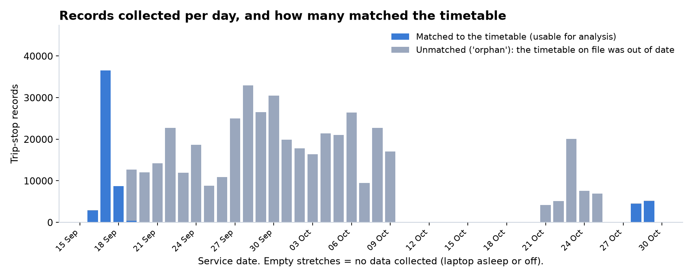
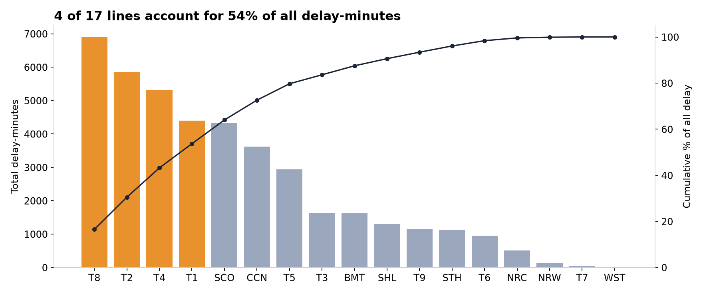
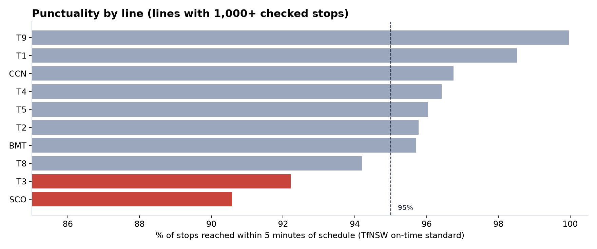
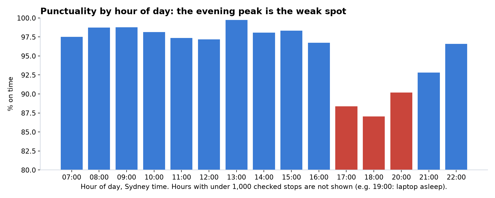

# Findings: what the data says

Answers to the questions a rail operator would ask, computed from the Gold tables in Databricks.
Everything here is reproducible: `python analysis/generate_findings.py` redraws the charts from
the warehouse. Figures are as of **29 Oct 2026** and will shift as data accumulates.

## Basis, and why the sample is small

| | |
|---|---|
| Stop events scored | **57,363** (passenger train services only) |
| Usable days | 16, 17, 18 Sep (full), 19 Sep (partial), 28 and 29 Oct (growing) |
| On time | arrival no more than 5 minutes late (TfNSW's Customer On-Time standard) |
| Excluded | trips that don't match the timetable (orphans), cancelled trips, delay outliers (under -10 min or over 2 h), and the non-revenue "RTTA_REV" service |

Why only five days out of about six weeks? See the [incident log](runbook.md#incident-log). In
short: the timetable on file went out of date on 19 Sep and the laptop that collects the data was
off for stretches. The raw records for the other days are kept in Bronze, but they cannot be
checked against a timetable that was never captured, so they are not scored.

## Network headline

**96.2% of stops were reached on time**, average delay **0.73 minutes**. Sydney Trains is mostly
punctual in this sample. The interesting story is concentration, not the average.

## Which lines cause the most delay? (volume view)

Delay-minutes add up lateness across every stop, so busy lines score high. Top lines:

| Line | Share of all delay-minutes | Cumulative |
|---|---|---|
| T8 | 16.5% | 16.5% |
| T2 | 14.0% | 30.5% |
| T4 | 12.7% | 43.2% |
| T1 | 10.5% | 53.7% |
| SCO | 10.3% | 64.0% |

**Four of 17 lines account for about 54% of delay-minutes.** If effort had to be spread thinly,
this says where to look first.

## Which lines are least punctual? (passenger view)

A line can be a big delay contributor simply by running a lot of trains (T1 is the busiest and
among the most punctual). Punctuality removes that effect:

| Line | % on time | Average delay (min) | Stops scored |
|---|---|---|---|
| SCO (South Coast) | 90.7 | 1.43 | 3,028 |
| T3 | 92.2 | 1.03 | 1,606 |
| T8 | 94.2 | 0.91 | 7,609 |
| T5 | 96.0 | 1.33 | 2,221 |
| T2 | 96.0 | 0.66 | 8,860 |
| T1 | 98.5 | 0.39 | 11,454 |
| T9 | 99.9 | 0.22 | 5,312 |

T8 appears on both lists: large *and* below-average punctuality, which makes it the strongest
single candidate for attention.

## When is it worst?

The **evening peak**:

| Hour (Sydney) | % on time | Avg delay (min) |
|---|---|---|
| 08:00 | 98.7 | 0.31 |
| 09:00 | 98.8 | 0.26 |
| 15:00 | 98.3 | 0.34 |
| 17:00 | **88.4** | **2.28** |
| 18:00 | **87.1** | **1.96** |
| 20:00 | 90.2 | 1.77 |
| 22:00 | 96.6 | 0.73 |

Hours with fewer than 1,000 scored stops are omitted (for example 19:00, when the laptop was
asleep), so read the chart as a pattern, not a precise hourly measurement.

## Where on the network?

Stop-level ranking needs more history. With about five days, only one stop reaches the
300-observation minimum used to keep rankings from being noise (Central Station Platform 16, T1:
307 observations, 95.4% on time), so no meaningful "worst stops" list exists yet. This is the
clearest case where more collected data would sharpen the answer.

## Do service alerts explain delays?

`mart_alert_delay_impact` compares each route's delay while an alert was active with that same
route's own baseline.

- 26 alert windows ("Buses replace trains", cause MAINTENANCE), 1,931 observations in total.
- Average difference: **+0.4 minutes**. For the 16 windows with 20 or more observations the
  average is **-0.29 minutes**, i.e. no meaningful increase.
- The largest single effect (+11.1 minutes, route IWL_1c) rests on **2 observations**.

Conclusion: in this sample, alerts are not a strong predictor of delay on the affected route.
One possible reason (untested): a bus replacement takes the scheduled train off the track, so
there is less train delay left to measure on that route.

## Why is it late?

This dataset records *that* a train was late, not *why*. What it supports:

- The pattern points to **demand and congestion** (the weak window is the evening commute),
  which is a hypothesis, not a result.
- The alert data does not show disruption notices driving the delay.

To answer "why" you would need: several months of history (seasonal and event effects), weekend
coverage (only 358 weekend stop events here), vehicle positions (dwell time at platforms), and
external data (weather, events, track work calendars).

## What this analysis is, and is not

It is a worked example of taking a live public feed to a defensible, caveated answer, with the
data-quality problems that appeared along the way found and fixed rather than hidden. It is not
a verdict on Sydney Trains: the sample is five days.
